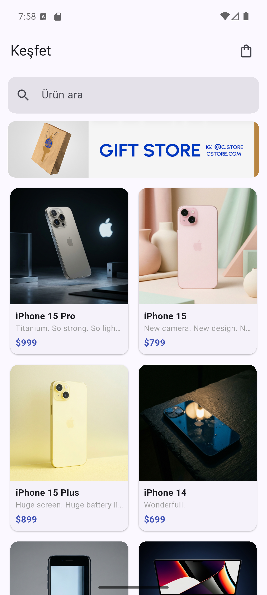
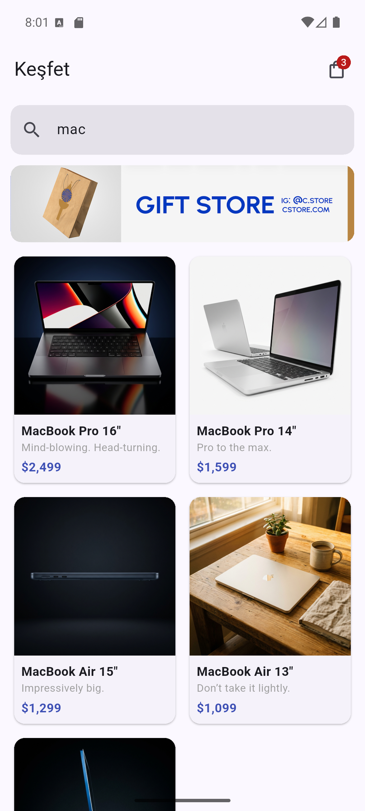
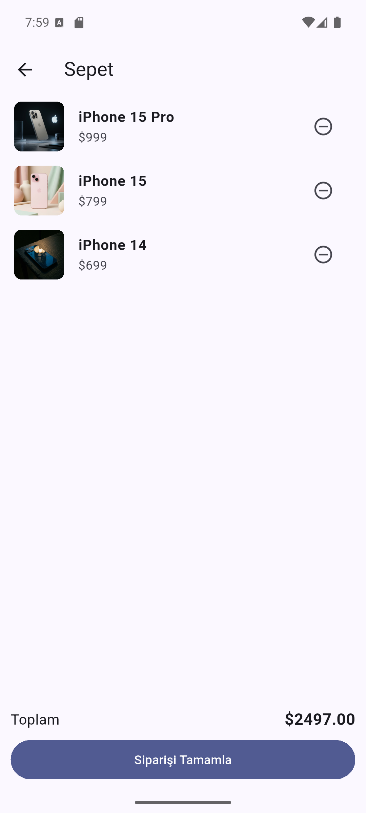

# Mini Katalog

Flutter ile geliştirilmiş basit bir ürün kataloğu uygulaması.
Mobil Uygulama Geliştirme (Android / iOS) eğitimi proje çalışması olarak hazırlanmıştır.

## Kısa Açıklama

Uygulamada ürünler ana sayfada kartlar halinde listelenir. Bir ürüne dokununca detay sayfası açılır, ürün buradan sepete eklenebilir. Sepet sayfasında eklenen ürünler ve toplam tutar görülür.

- **Ana sayfa:** arama kutusu, banner ve `GridView` ile ürün kartları
- **Ürün detayı:** görsel, açıklama, özellikler ve "Sepete Ekle" butonu
- **Sepet:** eklenen ürünler, ürün çıkarma, toplam tutar ve siparişi tamamlama (simülasyon)
- Sayfa geçişleri `Navigator` ve isimli rotalar ile yapılır, ürün bilgisi detay sayfasına route argument olarak taşınır
- Ürün verileri `assets/data/products.json` dosyasından okunur ve `Product` modeline çevrilir
- Ekstra paket kullanılmamıştır

## Ekran Görüntüleri

| Ana Sayfa | Arama | Ürün Detayı | Sepet |
| --- | --- | --- | --- |
|  |  |  |  |

## Kullanılan Flutter Sürümü

- Flutter 3.38.5 (stable)
- Dart 3.10.4

## Çalıştırma Adımları

1. Projeyi indirin:

   ```bash
   git clone https://github.com/AlperenYentur/mini_katalog.git
   cd mini_katalog
   ```

2. Paketleri yükleyin:

   ```bash
   flutter pub get
   ```

3. Bir emülatör açın veya Android cihaz bağlayın, sonra uygulamayı çalıştırın:

   ```bash
   flutter run
   ```

## Klasör Yapısı

```
lib/
├── main.dart                 # Uygulama girişi, tema ve rotalar
├── models/
│   └── product.dart          # Ürün modeli (fromJson / toJson)
├── data/
│   ├── product_service.dart  # JSON dosyasından ürünleri okuma
│   └── cart.dart             # Sepet
├── pages/
│   ├── home_page.dart        # Ana sayfa
│   ├── detail_page.dart      # Ürün detayı
│   └── cart_page.dart        # Sepet
└── widgets/
    └── product_card.dart     # Ürün kartı
assets/
├── data/products.json        # Ürün verileri
└── images/                   # Ürün görselleri ve banner
```

## Veri Kaynağı

Ürün verileri ve görseller eğitim amaçlı sunulan [wantapi.com](https://wantapi.com/products.php) adresinden alınmıştır. Gerçek bir e-ticaret altyapısını temsil etmez.
